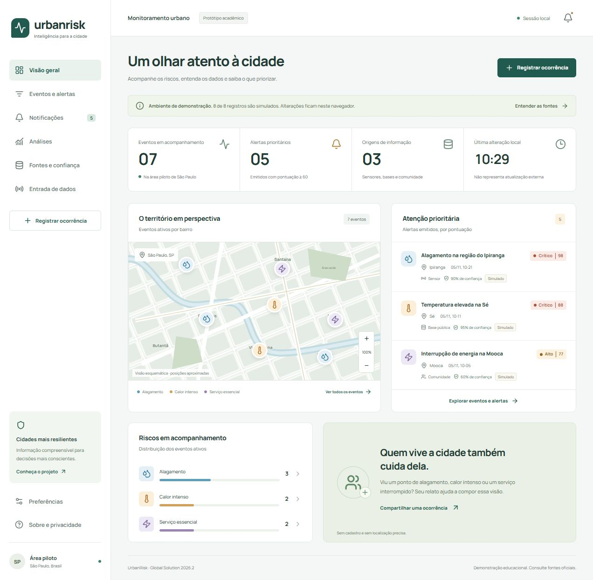

# UrbanRisk

**Global Solution 2026.2 · Engenharia de Software**

Aplicação web para acompanhar alagamentos, calor intenso e interrupções de serviços essenciais. A prioridade é explicada por severidade, confiança da origem, impacto estimado e recência.

## Equipe

| Integrante | RM |
| --- | --- |
| João Viviani Baldini | 558596 |
| Giuliano Ferreira Venceslau | 558674 |
| Enrico Nikolay Meirelles Zeronian | 558557 |

## Entregas

- [Documentação técnica em PDF único](output/pdf/UrbanRisk-Documentacao-Tecnica.pdf): problema, personas, 16 RF, 8 RNF classificados pela ISO/IEC 25010:2023, regras, diagramas UML, arquitetura e rastreabilidade.
- [Fontes editáveis dos diagramas](docs/diagramas).
- [Relatório de validação](docs/VALIDACAO.md) e [referência técnica de execução](docs/EXECUCAO.md).
- Configuração para Vercel em [vercel.json](vercel.json), com suporte às rotas da aplicação. Publicação pela equipe.
- Vídeo de até 3 minutos: gravação e publicação pendentes. O roteiro é material interno e fica fora deste repositório.

## Protótipo

Dez telas: visão geral, eventos, detalhe, notificações, registro comunitário, fontes e confiança, entrada de dados, análises, preferências e sobre/privacidade. O fluxo comunitário percorre registro, validação, confirmação, emissão de alerta, acompanhamento e encerramento.

React, TypeScript e Vite. Camadas de apresentação, aplicação, domínio e dados separadas. Testes das regras de negócio e CI em cada push/PR.

**Escopo demonstrativo:** processamento no navegador e persistência no localStorage, independentes por navegador. Oito cenários iniciais e sensores são simulados. A importação opcional do Open-Meteo consulta uma estimativa meteorológica externa para a Sé; não é confirmação de ilha de calor. Confiança por origem é uma hipótese de triagem, sem calibração estatística.

Não há backend compartilhado, autenticação de agentes, push remoto ou acionamento de serviços públicos. A arquitetura de produção está identificada como proposta no PDF. Não insira dados pessoais nos campos livres.
